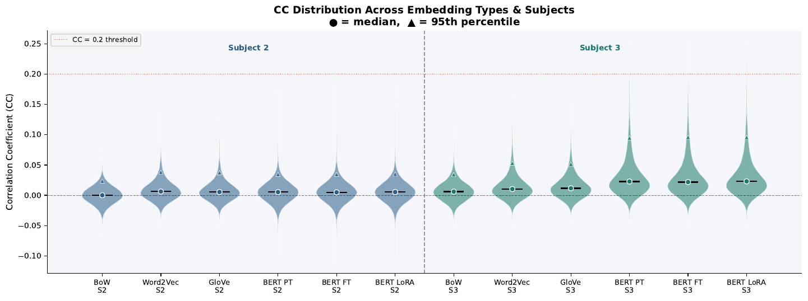
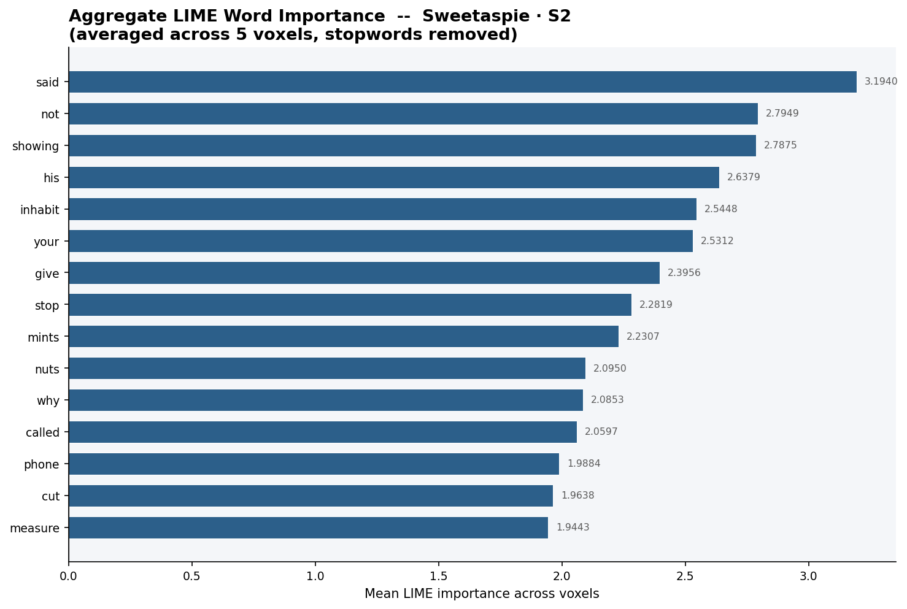

# Predicting Brain Activity from Language (fMRI Encoding Models)

**Which words make the brain light up while people listen to stories?** This project builds encoding models that predict fMRI brain activity (about 95,000 voxels, recorded every 2 seconds) from the words in spoken podcast stories. It compares simple word-count features, static word embeddings and BERT-based contextual embeddings, then uses SHAP and LIME to explain which words drive the predictions.

*Team project, STAT 214 (Data Science Practice), UC Berkeley, Spring 2026.*



## Results

- **Context matters.** Prediction accuracy followed a clear order: bag-of-words performed close to chance, Word2Vec and GloVe improved on it, and all three BERT variants (pretrained, MLM fine-tuned and LoRA fine-tuned) did best.
- **LoRA was the strongest variant** (mean voxel correlation 0.0221 for subject 2 across 19 held-out stories), slightly ahead of full fine-tuning while training far fewer parameters.
- **Dialogue words drive the response.** SHAP and LIME agreed that narrative and dialogue words, especially "said", had the largest influence on predicted activity, across stories and both subjects.
- **Stable across subjects.** The ranking of embeddings and the top LIME words held for both subjects, though subject 3 showed higher correlations overall.



## Approach

1. **Text features:** bag-of-words, Word2Vec, GloVe, and BERT embeddings (pretrained, fine-tuned with masked language modeling on the training stories, and LoRA-adapted).
2. **Alignment:** word-level embeddings downsampled to the fMRI time grid with Lanczos interpolation, plus time delays to model the brain's delayed blood-flow response.
3. **Encoding models:** ridge regression per voxel and per subject, with per-voxel penalties chosen by bootstrap cross-validation, evaluated on held-out stories by Pearson correlation.
4. **Interpretation:** SHAP (with a BERT mask-token masker) and LIME on the best-predicted voxels for two stories, plus stability checks across subjects.
5. **Compute:** jobs ran on HPC clusters with SLURM, handling roughly 25 GB of text and fMRI data per subject.

## My contributions

I handled **embedding preprocessing**, helped **run the ridge regressions**, and **led the SHAP and LIME interpretation analysis**: the implementation, the plots and the interpretation of which words drive voxel responses.

**Team:** Donjhai Holland, Larissa, Keyi and Lyla. Larissa generated the embeddings, coordinated the project and ran stability analysis for the interpretation results; Keyi led the BERT-based ridge models; Lyla trained the initial static-embedding ridge model and integrated the final report.

## Repository structure

```
code/
  preprocessing.py, data.py           # alignment, delays, data loading
  lab3_1_*                            # static embeddings and ridge models
  lab3_2_*                            # BERT feature extraction, MLM fine-tuning, LoRA, ridge
  lab3_3_*                            # SHAP and LIME interpretation and plots
  sbatch/                             # SLURM job scripts
ridge_utils/                          # ridge regression and interpolation utilities
figures/                              # SHAP and LIME figures
report/                               # full written report (PDF)
data/                                 # place the data here (not included)
```

## Running it

The fMRI recordings and story transcripts were provided through the course and aren't included. Set the data paths in the scripts (marked `/path/to/...`) and your Hugging Face username where you see `YOUR_HF_USER`, then:

```bash
conda env create -f environment.yaml
```

The `.sh` scripts were written for SLURM clusters; set your own allocation and paths before submitting.

## Tools

Python, PyTorch, Hugging Face Transformers, PEFT (LoRA), scikit-learn, SHAP, LIME, gensim, SLURM

## Reference

Jain, S., & Huth, A. G. (2018). Incorporating context into language encoding models for fMRI. *Advances in Neural Information Processing Systems 31 (NeurIPS 2018).*

---

**Donjhai "DJ" Holland** · [Portfolio](https://donjhaih.github.io) · [LinkedIn](https://www.linkedin.com/in/donjhai-holland)
